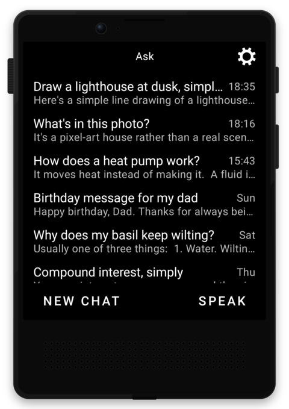
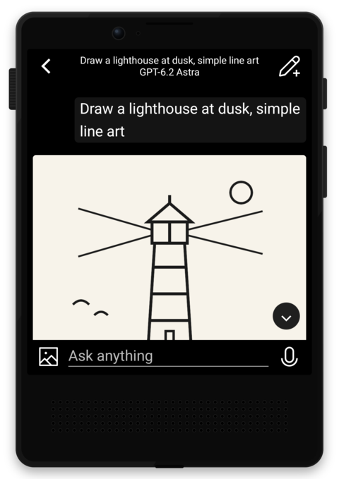
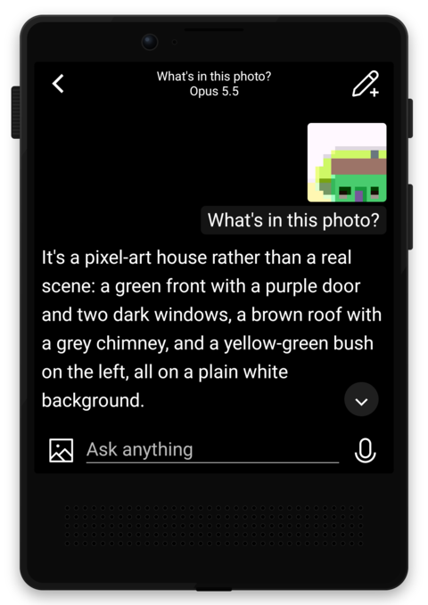
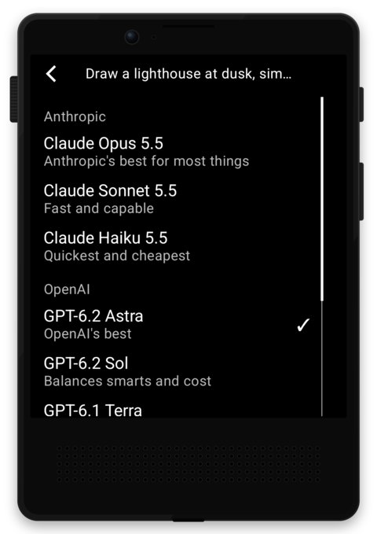
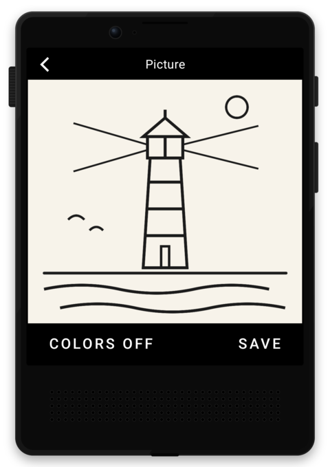
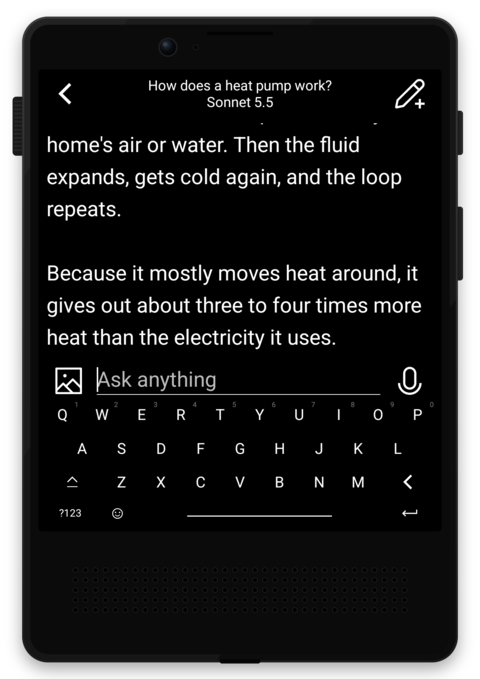

# Ask

Claude and GPT on the Light Phone III. Chats you can come back to, photos you can ask about, pictures drawn on request, answers that search the web, and speaking instead of typing, all in LightOS's black-and-white style.

Ask is a sideloaded app: you install it yourself over USB. It isn't part of Light's Tool Library and isn't made by or affiliated with Light, Anthropic or OpenAI. It uses your own API keys, so you pay the providers directly for what you use.

<p>
  
  
  
</p>

## What it does

- **Chats.** Every conversation is kept on the phone, newest first. Answers appear as they're written; the stop button keeps what's there so far. Tap an answer to copy it, ask again, or open its sources. Tap your last question to change it and ask again. Hold a chat in the list to rename or delete it.
- **Claude and GPT, side by side.** Tap a chat's title to switch models, even mid-chat: Claude Opus 5.5, Sonnet 5.5 and Haiku 5.5, or GPT-6.2 Astra, GPT-6.2 Sol, GPT-6.1 Terra and GPT-6 Luna. Settings picks the model new chats start with.
- **Photos.** The picture icon sends a photo from the phone, or a new one from the camera, to ask about.
- **Pictures.** Ask for a picture and one is drawn: by GPT with OpenAI's image tool (it can also change a picture it made, or one you sent), or for Claude through OpenAI's image API. Open a picture full screen to zoom, show it in colour (COLORS ON), or SAVE it to the phone's gallery.
- **Web search.** When a question needs current information, the model searches the web. The pages it used are listed under the answer and open in the browser.
- **Speak.** The microphone dictates into the question line, with your words appearing as you talk. DONE lets you fix them first, SEND sends at once. SPEAK on the chat list starts a new chat by voice.
- **A keyboard made for the LP3.** Swipe typing, accents and digits on long press, emoji, an optional suggestions row, double space for a full stop, and drag the space bar to move the cursor.
- **Colour.** Settings › Colors shows all of Ask in colour while it's open, on an otherwise grayscale phone.
- **Cost.** Swipe a chat left in the list to see an estimate of what it has cost, at the providers' standard rates. Your providers' dashboards have the real figures.
- An optional daily limit on questions, if you want Ask to stay intentional.

<p>
  
  
  
</p>

## Install

You need a computer with [adb](https://developer.android.com/tools/releases/platform-tools) (Android platform-tools), a USB cable, and USB debugging turned on on the phone.

1. Download `ask-<version>.apk` from this repo's [Releases](../../releases).
2. Plug in the phone and install it:

   ```sh
   adb install -r ask-0.2.1.apk
   ```

   Ask then shows up among the phone's tools.
3. Allow photos, the microphone and the camera, and the colour switch. LightOS may not ask for these itself, so grant them once from the computer:

   ```sh
   for p in READ_MEDIA_IMAGES RECORD_AUDIO CAMERA WRITE_SECURE_SETTINGS; do adb shell pm grant io.github.sevgjan.ask android.permission.$p; done
   ```

   Each one is optional: without it, only the feature that needs it is unavailable.

## Add your API keys

Ask needs an [Anthropic](https://console.anthropic.com) key, an [OpenAI](https://platform.openai.com) key, or both. The OpenAI key also draws pictures and turns speech into text, whichever model answers.

Keys are long, so Ask lets you hand them over from your computer instead of typing them on the phone. Clone or download this repo, plug in the phone, and run:

```sh
python3 scripts/light-setup.py
```

A page opens in your browser with a field for each key. Paste them and press **Save to phone**. Ask opens on the phone and confirms the keys were saved. Two other ways, with no browser:

```sh
python3 scripts/light-setup.py --clipboard openai      # copy the key first; the clipboard is cleared afterwards (macOS)
op read op://Private/OpenAI/key | python3 scripts/light-setup.py --stdin openai   # from a password manager, here 1Password
```

How the keys are kept safe:

- The script holds a key in memory only: it's never written to disk, printed, or put on a command line. It goes to the phone once, over the USB cable (`adb reverse`), and only to Ask: the script checks which app on the phone is asking.
- On the phone, Ask encrypts each key with a key kept in the Android Keystore, and deletes the form's file as soon as it's read.

You can also type or paste a key on the phone in Settings › API keys, or use Light's Tool Manager if your LightOS has it.

## Privacy

Your questions, photos and the chat so far go to the provider of the chat's model, with your key. OpenAI requests are sent with `store: false`. Pictures you ask Claude for are drawn by OpenAI. Speech is streamed to OpenAI while you talk and isn't stored. Chats and pictures are kept only on the phone, in Ask's private storage, until you delete them. There is no account, no analytics and no server of Ask's own.

## Build

Ask is a [Light SDK](https://github.com/lightphone/light-sdk) tool (`tool/`) plus a small Android library (`engine/`) for what the SDK doesn't allow: colour on a grayscale screen, saving to the gallery, the camera, and opening links. To build it:

1. Clone [light-sdk](https://github.com/lightphone/light-sdk) and copy this repo's `tool/` and `engine/` folders into it, replacing its `tool/`.
2. Add `include(":engine")` to light-sdk's `settings.gradle.kts`.
3. Build: `./gradlew :tool:testDebugUnitTest :tool:assembleRelease`. The APK is `tool/build/outputs/apk/release/tool-release.apk`.

Release APKs are signed with the Light SDK's public development key, as SDK tools are by default, so an APK you build yourself installs over a downloaded one, keeping your chats and keys.

## License

MIT, see `LICENSE`.
